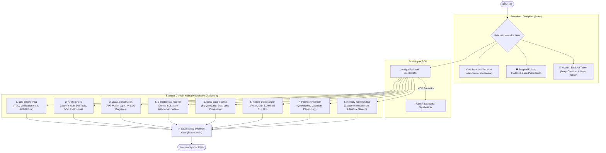

# ⚡ Duy Modern Agent Harness (`Duy-modern-agent-harness`)

> **The High-Performance Master Skills & Behavioral Optimization System for Modern AI Coding Agents.**  
> ออกแบบมาเพื่อยกระดับ AI Agent (Google Antigravity, Claude Code, Cursor, Windsurf, Codex) ให้ทำงานเฉียบคม แม่นยำ ไม่เพ้อเจ้อ และประหยัด Token สูงสุด

[](https://opensource.org/licenses/MIT)
[](skills/)
[](#-anti-bloat-architecture)
[](#-modern-saas-ui-design-system)
[](#-quick-start)

---

## 🌟 ทำไมต้องใช้ Duy Modern Agent Harness?

ในปัจจุบัน AI Agent มักเจอปัญหาหลัก 3 ประการ:
1. **Skill Bloat & Context Exhaustion:** การติดตั้งไมโครสกิลย่อยๆ นับร้อยตัว ทำให้ Token เริ่มต้นบวมไปกว่า 10,000–25,000 โทเค็นโดยที่ยังไม่ได้เริ่มเขียนโค้ด
2. **AI พูดจาเยิ่นเย้อ (Fluff & Hallucination):** เกริ่นนำยาว ชื่นชมผู้ใช้เกินจริง เคลมว่าเทสต์ผ่านทั้งที่ไม่ได้รันจริง และแก้โค้ดแบบเหวี่ยงแหจนไฟล์พัง
3. **ขาดความต่อเนื่องทางสถาปัตยกรรม:** ไม่มีมาตรฐานดีไซน์ UI ที่แน่นอน ไม่มีระเบียบความปลอดภัยเรื่องข้อมูล และขาดระบบความจำระยะยาว

**`Duy-modern-agent-harness`** แก้ไขปัญหานี้อย่างเบ็ดเสร็จด้วย **8 Master Domain Hubs** + **ระเบียบปฏิบัติ "พอดี lite"** + **Dual-Agent Orchestration SOP**

---

## 🏗️ สถาปัตยกรรมระบบ (System Architecture)



---

## 📦 แค็ตตาล็อก 8 Master Domain Hubs

ทุก Master Hub ใช้หลักการ **Progressive Disclosure** (สรุป Router สั้นกระชับใน `SKILL.md` และแยกเจาะลึกเฉพาะทางไว้ในโฟลเดอร์ `workflows/`) ทำให้ประหยัด Token ตั้งต้นได้มากกว่า 80%:

| # | Master Hub | ขอบเขตความเชี่ยวชาญ | ฟีเจอร์เด่น / นวัตกรรม |
| :-: | :--- | :--- | :--- |
| **01** | [`core-engineering`](skills/core-engineering/) | วิศวกรรมซอฟต์แวร์หลัก & TDD | ผสาน Karpathy rules, วงรอบเทสต์ 6 มิติ, Surgical Edits |
| **02** | [`fullstack-web`](skills/fullstack-web/) | เว็บแอปร่วมสมัย & UI/UX | มาตรฐาน Deep Obsidian & Neon Yellow Glassmorphism |
| **03** | [`visual-presentation`](skills/visual-presentation/) | นำเสนอ & ไดอะแกรมทางเทคนิค | สร้างไฟล์ `.pptx` แท้ (DrawingML) พร้อม 44 Standalone SVG Diagrams |
| **04** | [`ai-multimodal-harness`](skills/ai-multimodal-harness/) | ปัญญาประดิษฐ์และมัลติโมดอล | Live Bidirectional WebSocket, Omni-Flash Video, Dual-Agent |
| **05** | [`cloud-data-pipeline`](skills/cloud-data-pipeline/) | วิศวกรรมข้อมูลคลาวด์ | BigQuery, dbt, Spark + **ระบบหยุดตรวจก่อน DROP/DELETE** |
| **06** | [`mobile-crossplatform`](skills/mobile-crossplatform/) | โมบายล์แอป & ข้ามแพลตฟอร์ม | รวม 23 สกิล Flutter/Dart 3, Android CLI, Native C/C++ FFI |
| **07** | [`trading-investment`](skills/trading-investment/) | ระบบการลงทุนเชิงปริมาณ | Multi-Valuation (DCF/PE/PBV), Backtest, **Strict Paper-Only** |
| **08** | [`memory-research-hub`](skills/memory-research-hub/) | ความจำถาวร & วิจัยวิชาการ | เชื่อมต่อ Claude-Mem daemon (port 37777), arXiv, PubMed |

---

## 🎨 มาตรฐาน Modern SaaS UI Design System

ฮาร์เนสนี้บังคับใช้มาตรฐาน UI สากลที่ทันสมัยและสะกดสายตา (Modern Dark Glassmorphism) ให้กับทุกเว็บแอปที่ AI เจนขึ้นมา:

- **โทนสีหลัก (Core Palette):**
  - Background หลัก: `Deep Obsidian` (`#0B0B0E`) — *ไม่ใช้สีดำสนิท*
  - การ์ด & พื้นผิวยกระดับ: `Dark Slate` (`#14141B`)
  - สีเน้น (Accent / CTA): `Neon Yellow / Amber` (`#FACC15`)
  - ข้อความหัวข้อ: `Pure White` (`#F8F9FA`)
  - ข้อความเนื้อหา: `Cool Gray` (`#94A3B8`)
- **มิติและความลึก (Glassmorphism & Depth):**
  - การ์ดสำคัญใช้ `backdrop-filter: blur(16px)` พร้อมเส้นขอบบาง `border: 1px solid rgba(255, 255, 255, 0.08)`
  - แสงสะท้อนพื้นหลัง: Soft Radial Glow Blur Blobs กระจายอยู่เลเยอร์หลังสุด
- **Typography & Interaction:**
  - Headline ตัวหนาชัดเจน (Font-weight: 700–800) พร้อม Badge กำกับหมวดหมู่ `[ Category ]`
  - Hover Micro-interactions ลื่นไหลด้วย CSS Transitions

---

## 🚀 การติดตั้งและเริ่มต้นใช้งาน (Quick Start)

### 1. ติดตั้งแบบ 1 คลิกสำหรับ Windows (PowerShell)
เปิด PowerShell ในโฟลเดอร์ของคลังนี้ แล้วรันคำสั่ง:

```powershell
# ติดตั้งแบบ Global สำหรับ Antigravity IDE (แนะนำ)
.\install.ps1

# หรือ ติดตั้งเฉพาะในโปรเจกต์ปัจจุบัน (.agents/)
.\install.ps1 -Mode project
```

### 2. ติดตั้งแบบ 1 คลิกสำหรับ macOS / Linux (Bash)
```bash
chmod +x ./install.sh

# ติดตั้งแบบ Global
./install.sh

# หรือ ติดตั้งเฉพาะในโปรเจกต์ปัจจุบัน
./install.sh project
```

---

## 🧩 การนำไปใช้กับ AI ตัวอื่น (Claude Code / Cursor / Windsurf)

หากคุณหรือเพื่อนไม่ได้ใช้ Google Antigravity IDE สามารถนำระบบนี้ไปใช้ได้ทันที:

### สำหรับ Claude Code:
1. คัดลอกเนื้อหาจาก [`rules/personal_guidance.md`](rules/personal_guidance.md) ไปวางไว้ที่ไฟล์ `CLAUDE.md` ที่ Root ของโปรเจกต์
2. คัดลอกโฟลเดอร์ `skills/` ไปวางที่ `.claude/skills/`

### สำหรับ Cursor / Windsurf:
1. คัดลอกเนื้อหาจาก [`rules/personal_guidance.md`](rules/personal_guidance.md) ไปใส่ไว้ใน `.cursorrules`
2. เรียกใช้อ้างอิงกฎและสกิลได้ผ่านคำสั่ง `@skills/...`

---

## 🛡️ มาตรฐานความปลอดภัย (Safety & Integrity)

- **Zero-Destructive Operations:** ป้องกันการสั่งลบข้อมูลถาวร (`DROP TABLE`, `DELETE`, `TRUNCATE`) โดยไม่มีการยืนยัน
- **Zero-Live-Trade Guard:** งานด้านการเงินและบอทเทรดถูกจำกัดอยู่ในโหมดจำลอง (Paper Trading / Simulation) เสมอ
- **No Secrets Exposure:** คลังนี้ผ่านการตรวจสอบ Sanitization 100% ไม่มี API Key หรือข้อมูลระบุตัวบุคคล

---

## 📄 ใบอนุญาต (License)

เผยแพร่ภายใต้สัญญาอนุญาต [MIT License](LICENSE) — คุณสามารถนำไปใช้งาน ดัดแปลง และแจกจ่ายต่อได้อย่างอิสระเสรี

---

**Made with ⚡ by Duy** — Empowering the next generation of AI agentic engineering.
